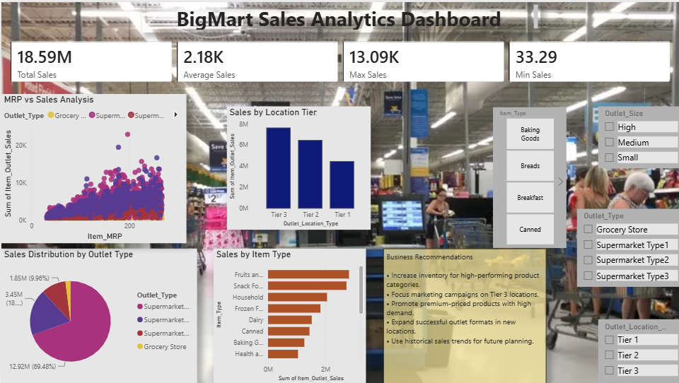

<h1 align="center">📈 Predictive Analytics Using Historical Data – BigMart Sales Analysis</h1>

---

## 📌 Project Overview

This project focuses on analyzing historical sales data from BigMart stores using Power BI. The objective was to identify sales patterns, evaluate outlet performance, and generate predictive insights through interactive dashboards.

The project includes data cleaning, preprocessing, feature engineering, KPI tracking, trend analysis, and interactive reporting to support data-driven business decisions.

---

## 🎯 Objective

- Analyze historical sales data.
- Identify factors affecting product sales.
- Build an interactive Power BI dashboard.
- Generate predictive insights using historical trends.
- Support business decision-making through data visualization.

---

## 📂 Dataset Information

The dataset contains product and outlet information including:

- Item Identifier
- Item Weight
- Item Fat Content
- Item Visibility
- Item Type
- Item MRP
- Outlet Identifier
- Outlet Establishment Year
- Outlet Size
- Outlet Location Type
- Outlet Type
- Item Outlet Sales

---

## 🔄 Data Preprocessing

### Data Cleaning

✔ Handled missing values in Item Weight and Outlet Size

✔ Standardized Item Fat Content values

✔ Verified data quality and data types

### Feature Engineering

Created the following calculated fields:

- Outlet Age
- Sales Category
- Visibility Category

---

## 📊 Dashboard Features

### KPI Cards

- 💰 Total Sales
- 📈 Average Sales
- 🔝 Maximum Sales
- 📉 Minimum Sales

### Visualizations

- Sales by Item Type
- Sales by Outlet Type
- Sales by Location Tier
- MRP vs Sales Analysis
- Sales Trend Analysis
- Outlet Age vs Sales Analysis

### Interactive Filters

- Item Type
- Outlet Size
- Outlet Location Type
- Outlet Type

---

## 📈 Predictive Analytics

Historical sales trends were analyzed to identify patterns and generate predictive insights.

Key analysis performed:

- Outlet Establishment Year vs Sales
- Outlet Age vs Sales Performance
- Product Pricing vs Sales Relationship
- Outlet Performance Comparison

---

### 📊 Sales Analytics Dashboard

  

---

### 📈 Predictive Analytics Dashboard

  

---
